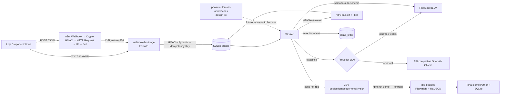

# AI Automation Hub

Portfólio de automação de processos e operações com IA de **Giulia Garbelini** (AI engineer júnior, Brasil). Todos os dados, empresas e pedidos são **fictícios**. Nenhum projeto está em produção, nenhum integra ERP real e não há métricas de economia de tempo.

## Problema

Operações de e-commerce e compras recebem pedidos e mensagens por vários canais. Sem controle, o mesmo pedido é cadastrado duas vezes, falhas temporárias viram perda de dados e mensagens urgentes (reembolso, cancelamento) ficam na fila errada. Este hub reúne três peças de estudo que atacam partes desse problema: receber e classificar eventos com segurança, cadastrar pedidos com um robô auditável e desenhar aprovações humanas.

## Projetos

| Projeto | Origem | O que demonstra | Situação |
| --- | --- | --- | --- |
| [rpa-pedidos](projects/rpa-pedidos/README.md) | Existente (nov/2026), preparado com apoio de IA | Node + Playwright preenchendo um portal Python/SQLite; fila JSON persistente, retomada, retries com backoff, lock, `eventos.jsonl`, screenshots, relatório HTML/CSV | Implementado; testes locais passaram (abaixo) |
| [power-automate-aprovacoes](projects/power-automate-aprovacoes/README.md) | Existente, preparado com apoio de IA | Especificação de aprovação de documentos com SharePoint e Approvals | **Design kit — não validado** (nenhum fluxo executado em conta Microsoft) |
| [webhook-llm-triage](projects/webhook-llm-triage/README.md) | **Extensão criada em nov/2026 com apoio de IA (Claude Code)** | FastAPI + HMAC + idempotência + fila SQLite + worker com LLM (saída validada por schema), retry/backoff/jitter, dead-letter, `/stats`, hand-off para o robô, fluxo n8n | Implementado; testes locais passaram; LLM real e n8n **não** executados |

## Arquitetura



## Como executar (comandos verificados em 19/11/2026, macOS, Node 24, Python 3.12)

### rpa-pedidos

```sh
cd projects/rpa-pedidos
npm ci
npx playwright install chromium     # baixa o navegador do Playwright (~95 MB)
PYTHON=python3.12 npm test          # 4 testes Python + 5 testes Node
PYTHON=python3.12 npm run test:e2e  # navegador headless: pausa/retomada, falhas simuladas
PYTHON=python3.12 npm run demo      # gera output/execucoes/<id>/relatorio.html
```

### webhook-llm-triage

```sh
cd projects/webhook-llm-triage
python3.12 -m venv .venv
.venv/bin/pip install --no-cache-dir -r requirements-dev.txt
.venv/bin/ruff check . && .venv/bin/ruff format --check .
.venv/bin/python -m pytest

export WEBHOOK_SECRET=segredo-local-de-demonstracao-123
.venv/bin/uvicorn --factory app.main:create_app --host 127.0.0.1 --port 8102
TRIAGE_API_URL=http://127.0.0.1:8102 .venv/bin/python scripts/send_event.py examples/pedido-novo.json
```

Variáveis em [`.env.example`](projects/webhook-llm-triage/.env.example) (sem valores reais).

## Exemplo de entrada e saída (saídas reais da execução local, provedor `fake-rules`)

Entrada ([`examples/suporte-reembolso.json`](projects/webhook-llm-triage/examples/suporte-reembolso.json), trecho):

```json
{"event_id": "evt_20261119_0002", "type": "support.message", "channel": "whatsapp",
 "message": "Fui cobrada duas vezes pelo pedido PED-0102, quero o estorno de uma das cobranças."}
```

Log JSON do worker:

```json
{"level": "info", "logger": "triage.worker", "msg": "event_processed", "queue_id": "evq_0fa7a99ce3314993", "attempt": 1, "event_type": "support.message", "provider": "fake-rules", "fallback_used": false, "category": "refund", "priority": "high", "action": "escalate_human", "rpa_handoff": false}
```

Pedido novo ([`examples/pedido-novo.json`](projects/webhook-llm-triage/examples/pedido-novo.json)) → `category: new_order`, `suggested_action: send_to_rpa` → CSV de hand-off:

```text
pedido;fornecedor;email;valor
PED-0101;Fornecedor Horizonte Fictício;contato@horizonte.example;890,00
```

Esse CSV foi passado ao robô (`node robo.cjs --entrada <csv> --saida <pasta>`), que retornou `"situacao": "concluida"`, `"cadastrados": 1`, `"rejeitados": 0`.

`GET /stats` após enviar 3 eventos válidos, 1 repetido, 1 inválido e 1 com assinatura errada:

```json
{"events_total": 3, "by_status": {"queued": 0, "processing": 0, "done": 3, "dead_letter": 0},
 "by_category": {"delivery_issue": 1, "new_order": 1, "refund": 1}, "attempts_total": 3,
 "llm_fallback_used": 0, "rpa_handoffs": 1,
 "webhook_since_start": {"accepted": 3, "duplicates": 1, "rejected_validation": 1, "rejected_signature": 1},
 "llm_provider": "fake-rules"}
```

## Resultados dos testes (execução local, 19/11/2026)

| Suite | Comando | Linha de resumo |
| --- | --- | --- |
| rpa-pedidos Python | `npm test` | `Ran 4 tests in 0.004s` / `OK` |
| rpa-pedidos Node | `npm test` | `ℹ tests 5` / `ℹ pass 5` / `ℹ fail 0` |
| rpa-pedidos navegador | `npm run test:e2e` | `RPA intermediário verificado: pausa/retomada, histórico preservado, rejeições sem retentativa, resposta perdida sem duplicata, trace, indisponibilidade e reprocessamento.` |
| webhook-llm-triage | `python -m pytest` | `33 passed in 0.32s` |
| webhook-llm-triage lint | `ruff check .` / `ruff format --check .` | `All checks passed!` / `16 files already formatted` |

Os testes e2e usaram o Chromium headless baixado pelo Playwright 1.62.1. O workflow [`.github/workflows/ci.yml`](.github/workflows/ci.yml) roda as mesmas suítes em Ubuntu, mas **ainda não foi executado no GitHub**.

Testes do webhook cobrem: assinatura válida/inválida/adulterada, erros de validação (400/413/415/422), idempotência (duplicado e conflito 409), worker com sucesso e hand-off, CSV aceito pelo leitor do `rpa-pedidos`, retry com backoff e depois sucesso, limites do backoff com jitter, dead-letter, saída do LLM fora do schema com fallback, 429/5xx/timeout como erro transitório, recuperação após queda, worker em segundo plano ponta a ponta e estrutura do JSON n8n.

## Implementado vs. planejado

| Item | Situação |
| --- | --- |
| Robô RPA com fila persistente, retomada, retries, lock, auditoria e relatórios | Implementado e testado localmente |
| Webhook com HMAC, Pydantic, idempotência, fila SQLite, worker, retry/backoff/jitter, dead-letter, `/stats`, `/events/{id}`, logs JSON | Implementado e testado localmente |
| Provedor FakeLLM/regras determinísticas | Implementado (padrão) |
| Provedor OpenAI-compatível (OpenAI / Ollama) | Implementado; testado só com respostas simuladas, **sem chamada real** |
| Hand-off webhook → rpa-pedidos (CSV de entrada) | Implementado; verificado com uma execução manual do robô |
| Fluxo n8n (`n8n/webhook-llm-triage.json`) | Escrito como JSON; **validado só estruturalmente**, não importado nem executado no n8n |
| Dockerfile / docker-compose do webhook | Incluídos; **não construídos** nesta validação |
| CI no GitHub Actions | Incluído; ainda não executado no GitHub |
| Aprovação Power Automate | Design kit, não validado |
| Make, ERP real, fila distribuída, painel Power BI, reprocessamento de dead-letter, avaliação de qualidade de LLM | Não implementados |

## Limitações

- Projetos de estudo, execução local, um único worker por processo.
- Endpoints de leitura do webhook não têm autenticação; sem proteção contra replay além da idempotência.
- A classificação padrão é por palavras-chave, não por modelo; nenhum LLM real foi avaliado.
- O robô usa Python (`PYTHON`) para ler CSV e subir o portal demo; o portal não é um sistema real.

## Origem e honestidade

- `rpa-pedidos` e `power-automate-aprovacoes` foram copiados do portfólio existente de Giulia (pasta de estudos de nov/2026), sem alterar o código. Na cópia: foram excluídos `output/`, bancos SQLite, `node_modules`, `docs/exemplo/` (relatórios, logs e screenshots de execuções) e o workflow próprio do robô (substituído pelo `ci.yml` da raiz); foram adicionadas uma nota no README do robô e o selo "design kit — não validado" no kit Power Automate. As notas originais ("preparado com apoio de IA", "não é produção", "sem ERP") foram mantidas.
- `webhook-llm-triage` é uma **extensão criada em nov/2026 com apoio de IA (Claude Code)**.
- Estude, execute e personalize antes de apresentar em entrevistas.

## Licença

[MIT](LICENSE) — Copyright (c) 2026 Giulia Garbelini. Os projetos copiados mantêm seus próprios arquivos `LICENSE`.
