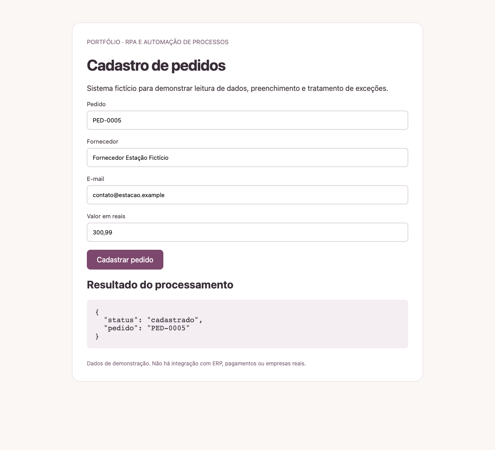
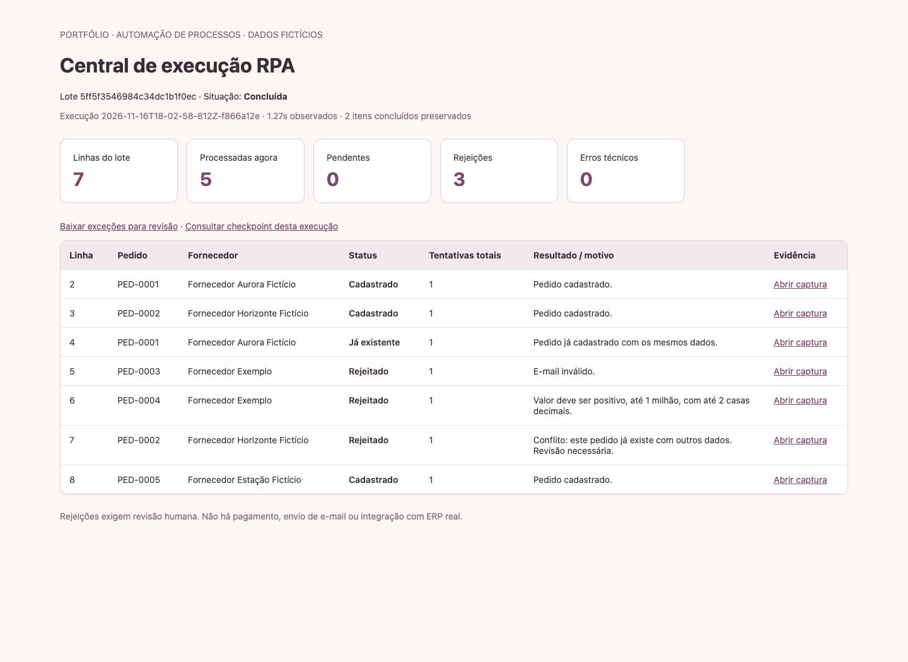

# Automação de Cadastro de Pedidos com RPA

Projeto de estudo e portfólio que automatiza a leitura de pedidos em CSV, o preenchimento de um portal de demonstração e o registro dos resultados.

O projeto contém duas implementações: uma em Python/Node.js com Playwright e outra montada no Power Automate Desktop.

> Todos os fornecedores, e-mails e pedidos são fictícios. Não há integração com ERP, pagamentos ou empresas reais.



## Objetivo

Demonstrar automação de um processo operacional com:

- Leitura de dados estruturados.
- Preenchimento de formulários.
- Validação de dados.
- Identificação de duplicidades e conflitos.
- Separação entre sucesso, rejeição e falha técnica.
- Registro dos resultados para conferência.

## Tecnologias

| Tecnologia | Uso |
|---|---|
| Python | Portal local, leitura e validação dos pedidos |
| SQLite | Persistência dos pedidos no sistema de demonstração |
| Power Automate Desktop | Automação do navegador no Windows |
| JavaScript | Consulta do estado do processamento no portal |
| Node.js e Playwright | Implementação alternativa do robô |
| CSV, TXT e HTML | Entrada de dados e relatórios |

## Implementações

### Power Automate Desktop

Fluxo montado no Windows para:

1. Abrir o portal no Microsoft Edge.
2. Ler o arquivo CSV.
3. Percorrer os pedidos com `For each`.
4. Preencher fornecedor, pedido, e-mail e valor.
5. Pressionar o botão de cadastro.
6. Consultar o status até o término do processamento.
7. Ler a resposta completa.
8. Acrescentar o resultado a um relatório TXT.

A consulta do status utiliza JavaScript:

```javascript
function ExecuteScript() {
    var elemento = document.getElementById('resultado');
    return elemento.getAttribute('data-status');
}
```

A leitura direta foi adotada após os testes identificarem divergências na leitura do atributo pela ação nativa.

O passo a passo do laboratório está em [POWER_AUTOMATE_DESKTOP.md](POWER_AUTOMATE_DESKTOP.md).

### Python/Node.js com Playwright

Implementação que inclui:

- Fila local persistente.
- Checkpoint e retomada por item.
- Controle de tentativas.
- Prevenção de duplicidades no destino.
- Histórico de execuções.
- Relatórios HTML e CSV.
- Screenshots de evidência.
- Simulações de indisponibilidade e resposta perdida.

Esses recursos de fila e retomada pertencem à implementação Node.js. Não devem ser considerados implementados automaticamente no fluxo PAD.



## Estrutura principal

```text
rpa-pedidos/
├── dados/
│   └── pedidos.csv
├── docs/
├── demo.py
├── portal.html
├── ler_csv.py
├── robo.cjs
├── fila.cjs
├── relatorios.cjs
├── package.json
├── POWER_AUTOMATE_DESKTOP.md
├── test_demo.py
├── test-fila.cjs
├── testar-regras.cjs
├── testar-robo.cjs
└── README.md
```

O arquivo `relatorio_pedidos.txt` é gerado pelo fluxo PAD no caminho configurado na ação de gravação.

A pasta `output/` é criada pela implementação Node.js ao executar e guarda os resultados de cada execução. Ela não é versionada; os relatórios, eventos e screenshots de execuções anteriores (`docs/exemplo/`) também não foram incluídos nesta cópia do AI Automation Hub.

## Requisitos

### Para o fluxo PAD

- Windows.
- Power Automate Desktop.
- Microsoft Edge com a extensão do Power Automate ativada.
- Python 3.9 ou superior.
- Fluxo configurado com os caminhos locais do projeto.

### Para a implementação Node.js

- Python 3.9 ou superior.
- Node.js 20 ou superior.
- npm.
- Navegador instalado pelo Playwright.

## Executar o portal no Windows

Abra o PowerShell na pasta do projeto:

```powershell
python demo.py
```

Acesse:

```text
http://127.0.0.1:8770/
```

Mantenha o PowerShell aberto durante a execução do PAD.

O endereço é local: ele depende do servidor Python em execução no mesmo computador.

## Configurar o CSV no PAD

Na ação **Ler do arquivo CSV**, configure:

| Campo | Configuração |
|---|---|
| Arquivo | Caminho local de `dados\pedidos.csv` |
| Codificação | UTF-8 |
| Separador | Ponto e vírgula (`;`) |
| Primeira linha contém nomes das colunas | Ativado |
| Variável de saída | `CSVTable` |

Exemplo de entrada:

```csv
pedido;fornecedor;email;valor
PED-9002;Fornecedor Aurora Fictício;compras@aurora.example;1250,50
```

Os valores devem ser informados sem separador de milhar.

## Regras de negócio

- Pedido no formato `PED-0001`.
- Fornecedor e e-mail obrigatórios.
- E-mail deve atender à validação do sistema.
- Valor positivo, até R$ 1 milhão, com até duas casas decimais.
- Pedido existente com os mesmos dados retorna `ja_existente`.
- Pedido existente com dados diferentes é rejeitado.
- Um conflito não sobrescreve o cadastro original.

## Estados do processamento

| Status | Significado |
|---|---|
| `aguardando` | Nenhum processamento iniciado |
| `processando` | Solicitação em andamento |
| `cadastrado` | Pedido salvo |
| `ja_existente` | Pedido já cadastrado com os mesmos dados |
| `rejeitado` | Dados inválidos ou conflito |
| `erro_tecnico` | Falha técnica ou de comunicação |

Rejeições de negócio são resultados esperados nos cenários de teste.

## Relatório do PAD

Cada pedido gera um registro semelhante a:

```text
Pedido: PED-0003
Fornecedor: Fornecedor Exemplo
Valor: 210,00
Status: rejeitado
Resposta: {
  "erro": "E-mail inválido."
}
----------------------------------------
```

A gravação usa **Acrescentar conteúdo**. Portanto, novas execuções preservam os registros anteriores.

O valor registrado corresponde à entrada do CSV; ele não comprova, isoladamente, o conteúdo efetivamente preenchido no navegador.

## Executar a versão Node.js

Dentro da pasta do projeto:

```bash
npm install
npx playwright install chromium
npm run demo -- --visivel
```

Essa versão inicia seu próprio portal e o encerra ao terminar.

### Demonstrar pausa e retomada

```bash
npm run demo -- --saida output/estudo-retomada --limite 2
npm run demo -- --saida output/estudo-retomada
```

### Executar testes

```bash
npm test
npm run test:e2e
```

## Validação realizada

### Power Automate Desktop

Foi demonstrada uma execução com sete linhas e registro coerente entre status e resposta, incluindo:

- Pedidos já existentes.
- Conflitos de dados.
- E-mail inválido.
- Valor negativo.

### Python/Node.js

Em 19/11/2026, nesta cópia do AI Automation Hub (macOS, Node 24, Python 3.12):

- `npm test`: 4 testes Python (`Ran 4 tests` / `OK`) e 5 testes Node de regras e fila (`ℹ pass 5` / `ℹ fail 0`).
- `npm run test:e2e`: teste de navegador aprovado — pausa/retomada, histórico preservado, rejeições sem retentativa, resposta perdida sem duplicata, trace, indisponibilidade e reprocessamento.
- O mesmo conjunto roda no GitHub Actions do hub (`.github/workflows/ci.yml`), que passou na publicação.

Detalhes em [docs/VALIDACAO.md](docs/VALIDACAO.md). Em uma verificação anterior, em outro ambiente, os testes de navegador haviam ficado bloqueados por restrições daquele ambiente.

## Pendências conhecidas

- Concluir o teste de cadastro novo pelo PAD: o pedido de teste retornou “Valor inválido”, exigindo conferir o valor efetivamente enviado pelo formulário.
- Após o cadastro novo, repetir a execução para validar a prevenção de duplicidade desse pedido.
- Validar o cenário de tempo esgotado no PAD.
- Disponibilizar uma exportação do fluxo PAD, se ainda não estiver incluída no repositório.

O projeto permanece como laboratório de estudo, sem implantação em produção comprovada.

## Aprendizados

- Seletores devem identificar o campo ou elemento correto.
- Ações de um pedido precisam permanecer dentro do mesmo `For each`.
- Respostas assíncronas exigem espera antes da leitura.
- Status e mensagem precisam ser conferidos em conjunto.
- Histórico de testes deve ser separado dos resultados de uma execução de demonstração.

## Autoria

Projeto de portfólio de Giulia Garbelini, desenvolvido com apoio de inteligência artificial.

## Licença

MIT. Consulte o arquivo `LICENSE`.
